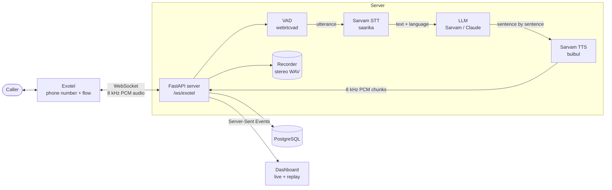
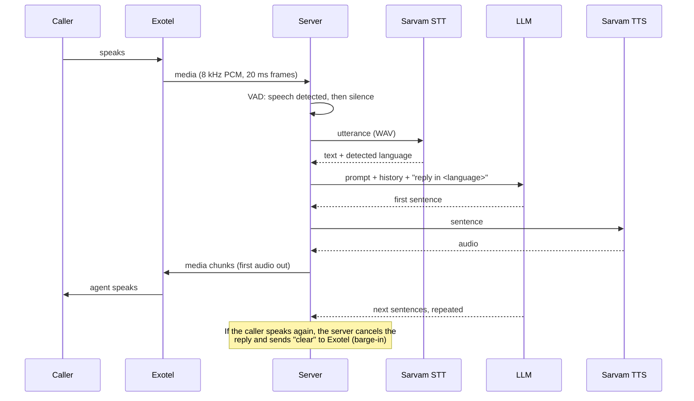

# Voice Agent

A real-time **AI phone agent** for India. People call a phone number (or the agent calls them), and the agent
listens, thinks and talks back in the caller's own language, with every call logged, recorded and
replayable in a live dashboard.

```
Phone call -> Exotel -> WebSocket -> VAD -> Sarvam STT -> LLM -> Sarvam TTS -> back to the caller
                                     |
                                     +-> PostgreSQL (agents, calls, per-turn latency)  +  recordings + live dashboard
```

## Features

- **Inbound and outbound calls** through Exotel (Voicebot applet over WebSocket).
- **Voice activity detection (VAD)** to find where the caller starts and stops speaking.
- **Barge-in**: the caller can interrupt the agent mid-sentence; the agent stops and listens.
- **Multilingual**: detects the caller's language each turn and answers in it
  (English, Hindi, Marathi, Bengali, Tamil, Telugu, Kannada, Malayalam, Gujarati, Punjabi, Odia).
- **Low latency by design**: pre-generated greeting, shared warm HTTP connections, sentence-level
  streaming from the LLM into text-to-speech.
- **Pluggable LLM**: Sarvam (default) or Anthropic Claude, switched with one environment variable.
- **PostgreSQL storage** of agent configuration, calls and every turn with its timings.
- **Live dashboard**: active calls, a real-time event feed, p50/p95 latency, and call replay with a
  waveform, transcript and per-stage latency bars.
- **Editable agents**: prompt, greeting, language and voice live in the database and can be changed
  through the API without redeploying.

## Architecture

### The pipeline



| Stage | What it does | Where |
|---|---|---|
| **Exotel** | Owns the phone number, answers the call, streams caller audio to us over a WebSocket and plays back the audio we send | Exotel dashboard (flow with the Voicebot applet) |
| **WebSocket server** | Receives `start` / `media` / `stop` events, sends `media` and `clear` events | `app/main.py`, `app/session.py` |
| **VAD** | Splits the continuous audio stream into utterances and detects when the caller starts speaking (for barge-in) | `app/vad.py` |
| **STT** | Turns one utterance into text and detects the language | `app/stt.py` (Sarvam `saarika`) |
| **LLM** | Writes the reply using the agent's prompt and the conversation so far, one sentence at a time | `app/llm.py` |
| **TTS** | Turns each sentence into speech in the right language | `app/tts.py` (Sarvam `bulbul`) |
| **Storage** | Agents, calls, turns, timings; stereo call recordings | `app/db.py`, `recordings/` |
| **Dashboard** | Live events and call replay | `app/static/index.html`, `/api/stream` |

### What happens in one turn



### Latency

For every reply the server measures, and stores in Postgres:

```
total reply latency  =  VAD wait  +  STT  +  LLM (first sentence)  +  TTS (first sentence)
```

| Part | Meaning | Typical |
|---|---|---|
| VAD wait | Silence needed before we decide the caller finished (`VAD_SILENCE_MS`) | 700 ms |
| STT | Speech to text | 200-350 ms |
| LLM | Time to the first complete sentence | 200-400 ms |
| TTS | Time to synthesize that first sentence | 450-1100 ms |
| **Total** | Caller stops talking until the agent starts talking | about 1.7-2.8 s |

The greeting is pre-synthesized at startup, so it plays with no waiting. Later sentences are synthesized
while earlier ones are already playing. The dashboard shows each number per reply.

### Multilingual flow

1. STT is called with `language_code=unknown`, so Sarvam detects the language.
2. The detected language becomes the call's current language (a one-word noise such as "hmm" does
   not change it).
3. The LLM gets the instruction to answer in that language and script, with a short reminder placed
   next to the caller's latest message. Without that reminder the model tends to copy the language of
   its earlier replies.
4. TTS speaks the reply with that language code.

`bulbul:v3` voices work across all supported languages. The faster `bulbul:v4-flash` voices are tied to
one language each, so multilingual agents use `v3`.

### Barge-in

When the VAD sees the caller start speaking while the agent is talking, the server cancels the
in-progress reply, trims the unplayed audio from the recording, and sends Exotel a `clear` event so
queued audio is dropped. The interrupted reply is stored with `interrupted = true`.

## Database

PostgreSQL, tables created automatically on startup.

| Table | Purpose | Key columns |
|---|---|---|
| `agents` | One row per agent persona | `name`, `system_prompt`, `greeting`, `language`, `voice`, `config` (JSON: `multilingual`, `locked`) |
| `calls` | One row per call | `call_sid`, `direction` (inbound/outbound), `from_number`, `to_number`, `status`, `duration_s`, `recording_path` |
| `turns` | One row per utterance or reply | `role`, `text`, `stt_ms`, `vad_ms`, `llm_ms`, `tts_ms`, `total_ms`, `offset_ms`, `interrupted` |

Agents defined in `app/prompts.py` are synced to the database on every start, unless the agent was
edited through `PUT /api/agents` (it is then marked `locked` and the database wins).

## Dashboard

Open `http://localhost:8000/` and enter your `API_KEY` once.

- **Live calls**: who is on the line and the state (listening, caller speaking, thinking, speaking).
- **Live event feed**: every stage with its time in ms, caller and agent text, detected language, barge-ins and errors.
- **Latency cards**: p50 and p95 total latency, and average VAD, STT, LLM and TTS.
- **Call list**: direction, duration and average latency.
- **Replay**: a stereo recording (left = caller, right = agent), waveform with turn markers, click to seek,
  a per-reply bar split into VAD / STT / LLM / TTS, and a transcript that follows playback.
- **Dial box**: start an outbound call from the page.

## Getting started

### Prerequisites

- Docker and Docker Compose
- An [Exotel](https://exotel.com) account with a phone number and the **Voicebot** applet enabled
- A [Sarvam](https://www.sarvam.ai) API key (speech-to-text, text-to-speech, and the default LLM)
- [ngrok](https://ngrok.com) or any other way to expose port 8000 over HTTPS/WSS
- Optional: an Anthropic API key if you prefer Claude as the LLM

### 1. Configure

```bash
cp .env.example .env      # Windows: copy .env.example .env
```

Fill in `.env` (see the table below). **Never commit `.env`**; it is git-ignored.

### 2. Run

```bash
docker compose up --build
```

This starts PostgreSQL and the app on port 8000. Check `http://localhost:8000/health`.

### 3. Expose the server

```bash
ngrok http 8000
```

Copy the forwarding host (for example `abcd.ngrok-free.dev`) into `PUBLIC_HOST` in `.env`.
Keep ngrok running while you test; if it stops, Exotel cannot reach the server and calls hang up
after a few seconds.

### 4. Connect Exotel

1. In the Exotel dashboard open **Apps / Flows** and edit the flow attached to your number.
2. Add the **Voicebot** applet and set its URL to:
   ```
   wss://<PUBLIC_HOST>/ws/exotel?agent=frontdesk
   ```
3. Save, and make sure your Exotel number is assigned to this flow.
4. The flow's **App ID** (shown in the Apps list) goes into `EXOTEL_FLOW_APP_ID` for outbound calls.

### 5. Call it

- **Inbound**: call your Exotel number. On a trial account, call from your registered number.
- **Outbound**: use the dial box in the dashboard, or
  ```bash
  curl -X POST http://localhost:8000/api/calls/outbound \
    -H "X-API-Key: $API_KEY" -H "Content-Type: application/json" \
    -d '{"to": "+91XXXXXXXXXX", "agent": "outbound"}'
  ```
  Exotel dials the number; when it answers, the call is connected to your flow, and the server
  recognises it as outbound and uses the agent you asked for.

## Configuration (`.env`)

| Variable | Purpose |
|---|---|
| `PUBLIC_HOST` | Public host Exotel reaches (no `https://`) |
| `API_KEY` | Protects the dashboard and `/api/*` |
| `OWNER_NAME`, `ASSISTANT_NAME` | Who the assistant answers for, and its name (used in prompts) |
| `DATABASE_URL` | Postgres connection (Docker Compose overrides it for the app container) |
| `EXOTEL_SID`, `EXOTEL_API_KEY`, `EXOTEL_API_TOKEN`, `EXOTEL_SUBDOMAIN` | Exotel REST credentials (outbound only) |
| `EXOTEL_NUMBER` | Caller ID for outbound calls |
| `EXOTEL_FLOW_APP_ID` | Flow that streams audio to this server (outbound only) |
| `SARVAM_API_KEY` | Sarvam key for STT, TTS and the default LLM |
| `SARVAM_STT_MODEL` | Speech-to-text model, e.g. `saarika:v2.5` |
| `SARVAM_TTS_MODEL` | Text-to-speech model, e.g. `bulbul:v3` |
| `SARVAM_LLM_MODEL` | LLM when `LLM_PROVIDER=sarvam`, e.g. `sarvam-105b-conversations` |
| `LLM_PROVIDER` | `sarvam` or `anthropic` |
| `ANTHROPIC_API_KEY`, `ANTHROPIC_MODEL` | Used when `LLM_PROVIDER=anthropic` |
| `VAD_AGGRESSIVENESS` | 0-3; higher filters more noise |
| `VAD_SILENCE_MS` | Silence that ends an utterance (lower = faster replies, more cut-offs) |
| `VAD_MIN_SPEECH_MS` | Ignore sounds shorter than this |

Model and voice names change over time. If Sarvam returns a 400 mentioning a deprecated model or an
unknown speaker, check their documentation and update the variable (the error message lists valid values).

## API

All `/api/*` routes need the header `X-API-Key: <API_KEY>`. The live stream and recording routes also
accept `?key=<API_KEY>` because browsers cannot set headers on `EventSource` or `<audio>`.

| Method and path | Purpose |
|---|---|
| `GET /health` | Liveness check |
| `GET /` | Dashboard |
| `WS /ws/exotel?agent=<name>` | Exotel Voicebot connects here |
| `POST /exotel/status` | Exotel call-status webhook |
| `GET /api/stream` | Server-Sent Events: live call events |
| `GET /api/calls` | Recent calls with average latency |
| `GET /api/calls/{id}` | Call details and turns with timings |
| `GET /api/calls/{id}/recording` | Stereo WAV recording |
| `GET /api/stats` | p50 / p95 / average latency per stage |
| `POST /api/calls/outbound` | Start an outbound call `{to, agent}` |
| `GET /api/agents`, `PUT /api/agents` | List or create/update an agent |

### Live event types

`call_started`, `speech_start`, `stage` (`stt` / `llm` / `tts` / `total` with `ms`), `user_utterance`,
`agent_reply`, `interrupted`, `error`, `call_ended`.

## Customising the agent

- **Prompt, greeting, voice**: edit `app/prompts.py` and run `docker compose up -d --build`, or use
  `PUT /api/agents` (no rebuild).
- **Prompt style for voice**: short replies (one or two sentences), plain spoken words, one question at
  a time. Text is spoken aloud, so avoid lists and markdown.
- **New agents**: add an entry to `AGENTS` in `app/prompts.py`, then point a flow at
  `wss://<PUBLIC_HOST>/ws/exotel?agent=<name>`.

## Project structure

```
app/
  main.py        FastAPI app: WebSocket endpoint, REST API, SSE stream, dashboard
  session.py     One live call: audio in, VAD, STT, LLM, TTS, audio out, timing, persistence
  vad.py         Streaming voice activity detection (webrtcvad)
  stt.py         Sarvam speech-to-text with language detection
  llm.py         LLM streaming (Sarvam or Claude) split into sentences
  tts.py         Sarvam text-to-speech + greeting cache
  audio.py       PCM/WAV helpers, resampling, chunking, stereo call recorder
  langs.py       Supported languages and per-turn language instructions
  prompts.py     Agent personas, prompts and greetings
  exotel.py      Outbound call API and outbound-call tracking
  events.py      In-process pub/sub for live dashboard events
  db.py          SQLAlchemy models and startup seeding
  config.py      Settings from environment
  static/index.html   Dashboard (vanilla JS, no build step)
Dockerfile, docker-compose.yml, requirements.txt, .env.example
```

## Troubleshooting

| Symptom | Likely cause and fix |
|---|---|
| Call is answered, then hangs up after 3-4 seconds | Exotel cannot reach the WebSocket. Make sure ngrok is running and the Voicebot applet URL is the current `wss://` address |
| Greeting plays but the agent never replies | Check the dashboard feed for an error. Usually the LLM account has no credit, or a model name is deprecated |
| `400` from Sarvam mentioning a model or speaker | Update `SARVAM_*_MODEL` or the agent voice; the error lists valid values |
| Dashboard keeps asking for the key | Enter the exact `API_KEY` from `.env` |
| Replies in the wrong language | Very short utterances are ignored for language switching; speak a full sentence |
| Replies feel slow | Lower `VAD_SILENCE_MS`; `bulbul:v4-flash` is faster for single-language agents |

## Security notes

- Secrets live only in `.env`, which is git-ignored. `.env.example` must contain no real values.
- `recordings/` holds real call audio and is git-ignored. Treat it as personal data and get consent
  from callers where the law requires it.
- Change `API_KEY` from the default and keep the repository private unless you are sure it contains no secrets.
- The dashboard and API are protected only by the API key; put them behind HTTPS and a firewall in production.

## Status and limitations

- The pipeline has been tested end to end with simulated callers using real Sarvam and LLM services,
  and live on an Exotel trial number. Test with your own account before relying on it.
- Speech-to-text runs per utterance (not streaming), which keeps the design simple at the cost of some latency.
- Live-call state (such as which agent an outbound call should use) is kept in memory; running multiple
  server instances would need shared state.
- Call recordings are stored on local disk; use persistent storage in production.

## License

Add a license of your choice before sharing publicly.
